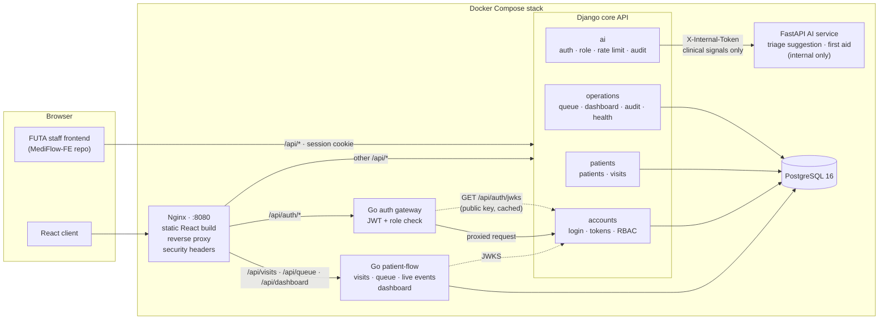
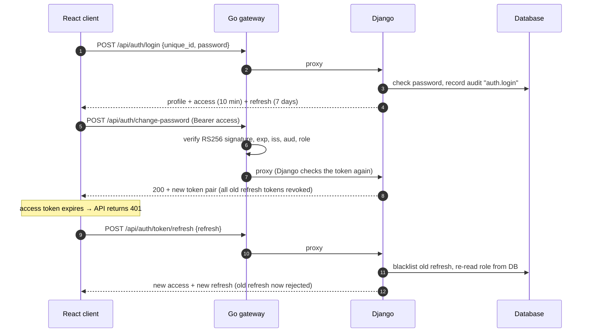
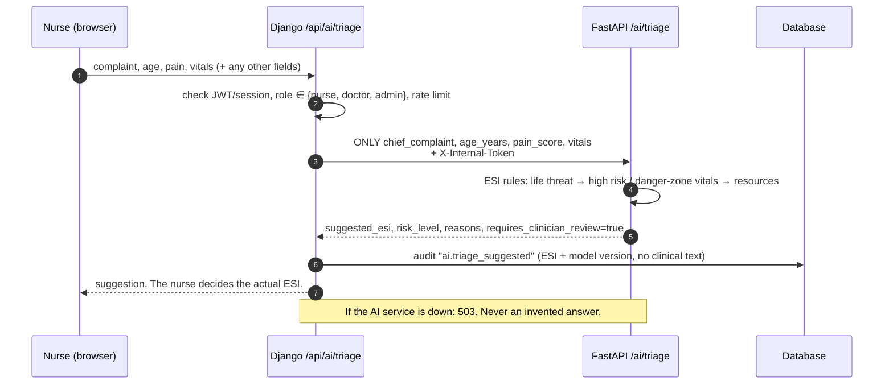
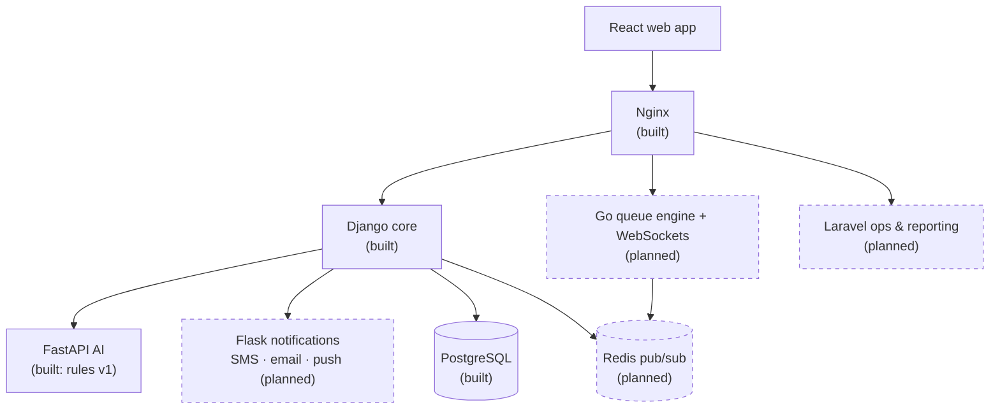
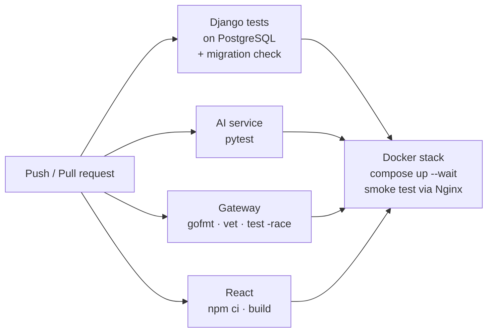

# MediFlow — Project Status, Architecture and Run Guide

_Last updated: 2026-10-12 · Repository: `MediFlow-io/mediflow-platform` (single repo for the whole team)_

This page covers what has been built, how the pieces fit together, how to run it, and what is left. It describes only what exists in this repository. Planned work is marked as planned.

**Contents**

1. [What MediFlow is today](#1-what-mediflow-is-today)
2. [Architecture](#2-architecture)
3. [What has been built](#3-what-has-been-built)
4. [How to run it](#4-how-to-run-it)
5. [What's left](#5-whats-left)
6. [Repository map](#6-repository-map)

---

## 1. What MediFlow is today

MediFlow handles patient flow for the FUTA Health Centre. Staff register patients and check them in as visits. Each visit gets an ESI triage level from 1 (most urgent) to 5. Each department has a queue ordered by **ESI first, then arrival time (FCFS)**.

| Part | Technology | Location | Status |
|---|---|---|---|
| Core API | Django 5 + Django REST Framework | `apps/core-api/` | ✅ Auth, RBAC, patients, staff, departments, student record, AI proxy, health check |
| **Admin console** | **Laravel 12** (PHP, Blade) | `apps/admin-console/` | ✅ Audit-log viewer, flow reports + CSV, department settings. Admins only, no own database |
| **Patient flow** | **Go** (pgx, PostgreSQL) | `apps/patient-flow/` | ✅ **Owns visits**: check-in, call/start/complete/cancel, queue, live events (SSE), flow dashboard |
| Auth gateway | Go (standard library only) | `apps/gateway/` | ✅ Proxies `/api/auth/*`, verifies JWTs and roles |
| AI service | FastAPI | `apps/ai-service/` | ✅ ESI triage suggestion and first-aid Q&A (rule-based, decision support only) |
| Web client | React 18 + Vite, served by Nginx | `apps/web/` | ✅ Staff app: dashboard, queue with call/start/complete/cancel, patients (search, register, edit, link student), check-in with AI triage suggestion, staff management, account |
| First-aid UI | React + TypeScript | `apps/first-aid-ui/` | ✅ Static first-aid and wellbeing tips |
| FUTA staff frontend | Plain HTML/JS | `apps/futa-web/` | Legacy; uses session login against the core API |
| Infrastructure & team automation | Docker Compose, GitHub Actions, `scripts/team_status.py` | `docker-compose.yml`, `.github/workflows/ci.yml` | ✅ One-command stack and CI (see the caveat in 4.1) |

The legacy FUTA staff frontend (vanilla JS, in the separate `MediFlow-FE` repo) calls the same API using session cookies.

---

## 2. Architecture

### 2.1 Current system



- **Only Nginx is published** (port 8080). Django, the gateway, the AI service and Postgres are reachable only inside the Compose network.
- **The AI service is never routed by Nginx.** Django calls it with a shared secret, after checking the user's login and role.
- Only Django holds the JWT **private** key. The gateway verifies tokens with the **public** key from `GET /api/auth/jwks`.
- When running without Docker, the React dev server (`:5173`) calls the gateway (`:8080`) directly instead of going through Nginx.

### 2.2 Authentication flow



### 2.3 AI triage suggestion flow



### 2.4 Target architecture (team plan)

The team guide in `Mediflow-Doc` plans more services. Dashed boxes are not built.



### 2.5 CI pipeline



---

## 3. What has been built

### 3.1 Core API (Django)

| Area | What works |
|---|---|
| **Accounts** | Custom `User` with roles: `admin`, `doctor`, `nurse`, `reception`, `lab`, `pharmacy`, `it`, `student` |
| **JWT auth** | RS256 access/refresh tokens. Refresh tokens are single-use and rotate; a reused one gets `401`. Logout and password change revoke refresh tokens. Role changes and deactivations take effect on the next refresh. |
| **Key management** | `apps/core-api/config/jwt_keys.py`. Production loads keys from env or PEM files and refuses to start without them. In debug mode a key pair is generated automatically (kept in a Docker volume under Compose). |
| **Public key** | `GET /api/auth/jwks` (also `/.well-known/jwks.json`) |
| **Sessions** | Cookie login still works for the legacy frontend (`/api/login`, `/api/logout`, `/api/session`) |
| **Registration** | Public student sign-up. Staff accounts are created only by admins. |
| **Patients** | Search and CRUD with the camelCase fields the frontend expects |
| **Visits & queue** | Visits with ESI 1–5. `GET /api/queue?department=opd` returns waiting patients sorted ESI, then FCFS. |
| **Dashboard** | Today's patients, number waiting, emergencies (ESI ≤ 2), counts per department |
| **AI proxy** | `POST /api/ai/ask` and `POST /api/ai/triage` (see 3.4) |
| **Health** | `GET /api/health` checks the database. Used by Docker health checks. |
| **Audit log** | Login, failed login, logout, self-registration, staff creation, password change, AI triage requests |
| **Seed data** | `python manage.py seed_demo` creates departments and demo staff accounts |

#### Who can do what (RBAC)

| Endpoint | admin | doctor | nurse | reception | lab | pharmacy | it | student |
|---|:-:|:-:|:-:|:-:|:-:|:-:|:-:|:-:|
| Read patients / visits | ✅ | ✅ | ✅ | ✅ | ✅ | ✅ | ❌ | ❌ |
| Create patients / visits | ✅ | ✅ | ✅ | ✅ | ❌ | ❌ | ❌ | ❌ |
| Update / delete patients / visits | ✅ | ✅ | ❌ | ✅ | ❌ | ❌ | ❌ | ❌ |
| Queue | ✅ | ✅ | ✅ | ✅ | ✅ | ✅ | ❌ | ❌ |
| Dashboard | ✅ | ✅ | ✅ | ✅ | ✅ | ✅ | ✅ | ❌ |
| AI triage suggestion | ✅ | ✅ | ✅ | ❌ | ❌ | ❌ | ❌ | ❌ |
| AI first-aid Q&A | ✅ | ✅ | ✅ | ✅ | ✅ | ✅ | ✅ | ✅ |
| Manage users / create staff | ✅ | ❌ | ❌ | ❌ | ❌ | ❌ | ❌ | ❌ |
| Create / edit departments | ✅ | ❌ | ❌ | ❌ | ❌ | ❌ | ❌ | ❌ |

Rules live in `apps/core-api/apps/accounts/permissions.py` and `apps/core-api/apps/ai/views.py`.

### 3.2 Go auth gateway

- Proxies `/api/auth/*` to Django with CORS, request logging, a 10-second timeout and a 1 MB body limit.
- Verifies JWTs on protected routes (signature, expiry, issuer, audience, access-token type) using Django's JWKS.
- Checks roles at the edge, for example `register/staff` needs `admin`. Django checks again regardless.
- Standard library only; no third-party dependencies.

### 3.3 React web client

- Screens for sign-in, student registration, staff registration, and change password.
- When a request gets `401`, it refreshes the token once and retries; concurrent requests share one refresh call.
- In Docker it is built into static files and served by Nginx on the same origin as the API.

### 3.4 AI service (FastAPI): decision support only

Follows `Mediflow-Doc/AI.md`. **It never diagnoses, prescribes, or sets a patient's ESI level.**

| Feature | What it does |
|---|---|
| **Triage suggestion** (`/api/ai/triage`) | Suggests ESI 1–5 using the ESI v4 steps: life-threat signs → high-risk complaint, new confusion, severe pain, or age-adjusted danger-zone vitals → expected resources. Returns the **reasons** for every suggestion and `requires_clinician_review: true`. |
| **First-aid Q&A** (`/api/ai/ask`) | Plain-language first-aid guidance for 17 topics (bleeding, burns, choking, seizures, fainting, and others). Emergencies start with "Call 112 now". Refuses dose and diagnosis questions. Wording matches the `MediFlow-AI` tips UI. |
| **Safety choices** | Ambiguity rounds toward more urgent. With no vitals, nothing is suggested below ESI 3. **No confidence score** is returned, because rules have no calibrated probability. |
| **Privacy** | Django forwards only complaint, age, pain score and vitals; names and record IDs never leave the core API. Request bodies are never logged. The audit log stores the suggested ESI, not the clinical text. |
| **Protection** | Internal `X-Internal-Token`, not routed by Nginx. Per-user rate limit (default 30/min). Timeout 3 s. Returns `503` on failure, never an invented answer. |
| **Observability** | Structured JSON logs, Prometheus `/metrics`, `/ai/health`, OpenAPI docs at `/docs` |

Model version: `rules-esi-2026.10`. A trained model can replace `suggest_esi()` later without changing the API.

### 3.5 DevOps

| Item | Details |
|---|---|
| **Dockerfiles** | One per service: Django (`apps/core-api/Dockerfile`), gateway (`apps/gateway/Dockerfile`, multi-stage), AI (`apps/ai-service/Dockerfile`), web (`apps/web/Dockerfile`: React build + Nginx). All run as non-root users. |
| **Compose stack** | `db`, `api`, `ai`, `gateway`, `web`. Health checks with start ordering. Migrations and demo seed run automatically. Postgres data and JWT keys are kept in volumes. Every setting has a dev default, so no `.env` is needed. |
| **Nginx** | Serves the React build, routes `/api/auth/*` to the gateway and `/api/*` to Django, and sets security headers. Does not route the AI service. |
| **Secrets hygiene** | `.gitignore` and `.dockerignore` keep `.env`, `.keys/`, `*.pem` and `db.sqlite3` out of git and out of images. Production refuses dev JWT keys and the dev AI token. |
| **CI** (`.github/workflows/ci.yml`) | On every push to `main` and every PR: Django tests on PostgreSQL + migration check, AI pytest, Go gofmt/vet/race tests, React build, then the full Docker stack with a smoke test through Nginx. The smoke test also checks that the AI service isn't exposed. |

### 3.6 Security fixes so far

| Problem found | Fix |
|---|---|
| Anyone could create an **admin** account | Staff creation is admin-only. Public registration ignores the requested role. |
| **Students could read every patient record** | Role-based permissions (table above) |
| Login returned **random strings** instead of real tokens | RS256 JWTs with rotation and revocation |
| Login **through the gateway could never work** (empty body reached Django) | Gateway forwards the body with a `Content-Length`; regression test added |
| **Change password always failed** | Field names fixed; current password required |
| Docker build would have copied the private key into the image | `.dockerignore` |

### 3.7 Tests

| Suite | Command | Count | Result |
|---|---|---|---|
| Django (auth, RBAC denials, patients, queue, AI proxy, health) | `cd apps/core-api && python manage.py test` | 28 | ✅ |
| Team status script (config validation, report, flags) | `pytest scripts/tests` | 9 | ✅ |
| AI service (triage rules, first aid, auth, validation, metrics) | `cd apps/ai-service && pytest` | 29 | ✅ |
| Go gateway (token verification, roles, proxy body) | `cd apps/gateway && go test ./...` | 4 | ✅ |
| React | none yet | — | — |

API contracts: [`docs/api/auth.yaml`](api/auth.yaml), [`docs/api/ai.yaml`](api/ai.yaml).

---

## 4. How to run it

### 4.1 Option A: Docker (whole stack, one command)

Requires Docker Desktop (Windows/macOS) or Docker Engine + Compose v2 (Linux).

```bash
git clone https://github.com/MediFlow-io/mediflow-platform.git
cd mediflow-platform
docker compose up --build
```

Open **<http://localhost:8080>** (staff app) and sign in with a demo account (4.4). The student dashboard runs at **<http://localhost:8081>** and the admin console at **<http://localhost:8082>** (sign in as `admin`). Stop with `Ctrl+C`; `docker compose down -v` also wipes the database and keys.

To change settings, copy `.env.example` to `.env` and edit it. Compose reads it automatically.

> ⚠️ This path has not been run end to end yet: Docker Desktop could not start on the machine these changes were made on. The Compose file passes `docker compose config`, and the CI `stack` job builds and smoke-tests the whole stack on every PR. Check that job's result on the first PR.

### 4.2 Option B: run each service locally (development)

Prerequisites: Python 3.12+, Go 1.22+, Node.js 18+ (22.12+ for the student dashboard), and **PostgreSQL**.
The Go patient-flow service shares the core API's database, so local development now needs PostgreSQL
instead of the SQLite default. Any local PostgreSQL works. Point both services at it:

```bash
export POSTGRES_DB=mediflow POSTGRES_USER=mediflow POSTGRES_PASSWORD=yourpassword POSTGRES_HOST=localhost POSTGRES_PORT=5432
```
 Commands are for **Git Bash** (macOS/Linux: use `bin` instead of `Scripts`).

> Django does **not** read `.env`. Locally, the defaults work as they are.

**One-time setup** (from the repo root):
```bash
python -m venv .venv
source .venv/Scripts/activate
pip install -r apps/core-api/requirements.txt -r apps/ai-service/requirements-dev.txt
(cd apps/web && npm install)
```

Then open **four terminals**, each starting in the repo root:

**Terminal 1: Django API → http://localhost:8000**
```bash
source .venv/Scripts/activate
cd apps/core-api
python manage.py migrate
python manage.py seed_demo
python manage.py runserver
```

**Terminal 2: AI service → http://localhost:8001/docs**
```bash
source .venv/Scripts/activate
cd apps/ai-service
uvicorn app.main:app --port 8001 --reload
```

**Terminal 3: Go gateway → http://localhost:8080**
```bash
cd apps/gateway
go run .
```

**Terminal 3b: Go patient-flow → http://localhost:8090** (visits, queue, dashboard)
```bash
cd apps/patient-flow
go run ./cmd/patient-flow        # uses the same POSTGRES_* variables
```

**Terminal 3c: Laravel admin console → http://localhost:8082** (PHP 8.2+, Composer)
```bash
cd apps/admin-console
composer install && cp .env.example .env && php artisan key:generate   # first time only
php artisan serve --port=8082
```

**Terminal 4: React client → http://localhost:5173**
```bash
cd apps/web
npm run dev
```

Open <http://localhost:5173> and sign in as `nurse` / `nurse123`. Stop any service with `Ctrl+C`.

**Optional, Terminal 5: student dashboard → http://localhost:5174** (needs Node 20.19+ or 22.12+)
```bash
cd apps/student-dashboard
npm install
npm run dev
```
A student sees data only after reception links their matric number to a patient record (Patients → Edit → *Linked account*). Without Terminal 2, everything works except the AI endpoints, which return `503`.

> **Git Bash on Windows:** use forward slashes in paths (`cd /c/Users/you/mediflow-platform`). Backslashes are escape characters there.

### 4.3 Quick API checks

```bash
# Log in (Docker: http://localhost:8080 · local: gateway on http://localhost:8080)
curl -s -H "Content-Type: application/json" \
  -d '{"unique_id":"nurse","password":"nurse123"}' http://localhost:8080/api/auth/login

# AI triage suggestion (Docker: :8080 · local: Django on :8000)
curl -s -H "Authorization: Bearer <access-token>" -H "Content-Type: application/json" \
  -d '{"chief_complaint":"chest pain","age_years":45,"vitals":{"heart_rate":110,"spo2":96}}' \
  http://localhost:8080/api/ai/triage

# First-aid question
curl -s -H "Authorization: Bearer <access-token>" -H "Content-Type: application/json" \
  -d '{"question":"What should I do for a burn?"}' http://localhost:8080/api/ai/ask

# Health
curl -s http://localhost:8080/api/health
```

### 4.4 Demo accounts

Created by `seed_demo` (automatically in Docker). **Local development only.**

| Username | Password | Role |
|---|---|---|
| `admin` | `admin123` | admin |
| `manager` | `manager123` | admin |
| `doctor` | `doctor123` | doctor |
| `nurse` | `nurse123` | nurse |

### 4.5 Run the tests

```bash
(cd apps/core-api && python manage.py test)
(cd apps/ai-service && pytest -q)
(cd apps/gateway && go test ./...)
(cd apps/patient-flow && go test ./...)
(cd apps/admin-console && php artisan test)   # add TEST_DATABASE_URL=...mediflow_test for the PostgreSQL tests
(cd apps/web && npm run build)
pytest -q scripts/tests
```

### 4.6 Environment variables

All are listed with defaults in [`.env.example`](../.env.example).

| Variable | Default | Purpose |
|---|---|---|
| `DJANGO_SECRET_KEY` | unsafe dev key | **Must** be set in production |
| `DJANGO_DEBUG` | `true` | `false` in production: requires JWT keys and the AI token, and enables password validators |
| `DJANGO_ALLOWED_HOSTS` | `localhost,127.0.0.1` (Docker adds `api`) | Allowed hostnames |
| `CORS_ALLOWED_ORIGINS` | dev origins | Browser origins allowed to call Django directly |
| `POSTGRES_*` | unset → SQLite locally; set by Compose | Database connection |
| `SEED_DEMO` | `true` (Docker) | Create demo data at startup; set `false` outside local dev |
| `JWT_PRIVATE_KEY` / `JWT_PUBLIC_KEY` / `JWT_KEYS_DIR` | generated in dev | Signing keys |
| `JWT_ISSUER` / `JWT_AUDIENCE` | `mediflow-core` / `mediflow` | Must match in every verifying service |
| `JWT_ACCESS_MINUTES` / `JWT_REFRESH_DAYS` | `10` / `7` | Token lifetimes |
| `AI_SERVICE_URL` | `http://localhost:8001` (Docker: `http://ai:8001`) | Where Django finds the AI service |
| `AI_SERVICE_TOKEN` | dev token | Shared secret, Django ↔ AI. Must be unique in production. |
| `AI_SERVICE_TIMEOUT` / `AI_RATE_LIMIT` | `3` s / `30/min` | AI call timeout and per-user limit |
| `AI_ENV` / `EMERGENCY_NUMBER` | `development` / `112` | AI service mode; emergency number in answers |
| `WEB_PORT` | `8080` | Host port for the Docker stack |
| Gateway: `DJANGO_BASE_URL`, `ALLOWED_ORIGIN`, `PORT` | `http://localhost:8000`, `http://localhost:5173`, `8080` | Gateway settings |
| `VITE_GATEWAY_URL` / `VITE_API_URL` | empty = same origin | Where the web app sends auth / API requests. Leave empty: Nginx (Docker) and the Vite dev proxy route `/api/auth/*` to the gateway and `/api/*` to Django |
| `MEDIFLOW_GATEWAY` / `MEDIFLOW_API` / `MEDIFLOW_FLOW` | `http://localhost:8080` / `:8000` / `:8090` | Vite dev-proxy targets (`npm run dev` only) |
| `JWKS_URL` / `TIME_ZONE` (patient-flow) | `http://localhost:8000/api/auth/jwks` / `Africa/Lagos` | Where Go gets signing keys; the hospital's local day |
| `VITE_STUDENT_DASHBOARD_URL` | `http://localhost:5174` | Where the web app sends students after sign-in |

Generate production JWT keys:
```bash
openssl genpkey -algorithm RSA -pkeyopt rsa_keygen_bits:2048 -out jwt_private.pem
openssl rsa -in jwt_private.pem -pubout -out jwt_public.pem
```

### 4.7 Troubleshooting

| Symptom | Cause / fix |
|---|---|
| `ImproperlyConfigured: JWT keys missing` | `DJANGO_DEBUG=false` without keys: set them or mount PEM files |
| `ImproperlyConfigured: Set AI_SERVICE_TOKEN` | `DJANGO_DEBUG=false` with the dev AI token: set a unique secret in Django **and** the AI service |
| `/api/ai/*` returns `503` | The AI service isn't running or `AI_SERVICE_URL`/`AI_SERVICE_TOKEN` don't match |
| `/api/ai/*` returns `429` | Per-user AI rate limit hit; wait a minute or raise `AI_RATE_LIMIT` |
| Everyone logged out after a restart | The JWT key changed (`.keys/` deleted, or the `jwt_keys` volume removed) |
| Docker: `port is already allocated` | Something else uses 8080: set `WEB_PORT=8090` in `.env` |
| Docker Desktop "unable to start" on Windows | Usually WSL 2 is missing: run `wsl --install` in an admin PowerShell, reboot, then start Docker Desktop |
| Browser CORS error (local dev) | Add your origin to `ALLOWED_ORIGIN` (gateway) or `CORS_ALLOWED_ORIGINS` (Django) |

---

## 5. What's left

### 5.1 Decisions needed

| # | Decision | Notes |
|---|---|---|
| D1 | **Remaining service ownership** | AI is now FastAPI (decided). Still open: Flask = notifications? Laravel = ops/reporting or billing? |
| D2 | **Product scope** | The code is a walk-in ESI queue. The MVP brief asks for appointments, prescriptions and billing. |
| D3 | **Main backend repo** | `MediFlow` and `MediFlow-BE` duplicate the Django code. Only `MediFlow` has the new work. |
| D4 | **Public `/api/register`** | Still creates `reception` accounts that can read patient data. Require approval, or retire it? |
| D5 | **Token revocation store** | Database now; Redis once Redis is in the stack |
| D6 | **Role names** | Existing roles kept, not the brief's `patient`/`receptionist`/`billing` |
| D7 | **Emergency number** | Defaults to `112` (Nigeria). Confirm, or add the campus emergency line. |
| D8 | **Clinical sign-off for AI rules** | A clinician should review `apps/ai-service/app/triage.py` thresholds and keyword lists before real use |

### 5.2 Remaining work, by priority

**P0: security and correctness**
- [ ] Rate-limit login and refresh (brute-force protection). AI endpoints are already limited.
- [ ] Schedule `python manage.py flushexpiredtokens` (for example, a daily job).
- [ ] Audit **patient record reads and writes**.
- [ ] Enforce password validators in all modes (currently off when `DEBUG=true`).
- [ ] Move tokens out of `localStorage`, or harden against XSS (CSP).
- [ ] Encrypt sensitive patient fields at rest.
- [ ] TLS: put HTTPS in front of Nginx (certificates or a cloud load balancer).
- [ ] Confirm the CI `stack` job passes on the first PR (first real Docker run).

**P1: core features**
- [ ] Visit lifecycle endpoints: call, start, complete, cancel.
- [ ] Separate clinical records from the `Patient` model.
- [ ] React staff dashboards: queue, patient search/registration, **triage form showing the AI suggestion**, first-aid chat for students.
- [ ] Move the legacy FUTA frontend to React, or serve it behind Nginx on the same origin.
- [ ] Appointments, prescriptions, billing, depending on D2.

**P2: AI (later phases, per the AI integration team plan)**
- [ ] Evaluation set for triage rules and first-aid answers (unsafe requests, ambiguous symptoms, failures), as `AI.md` requires.
- [ ] Trained triage model once a dataset, evaluation (precision/recall) and bias review exist. Swap it in behind `suggest_esi()`.
- [ ] Wait-time prediction, congestion and bottleneck detection.

**P2: planned services**
- [ ] Realtime queue: Go WebSocket hub with Redis pub/sub
- [ ] Notifications: SMS/email when a patient's turn is near
- [ ] Ops/reporting (and billing if in scope)

**P3: platform**
- [ ] Push images to a registry (GHCR) from CI; deploy to staging with manual approval for production
- [ ] Prometheus + Grafana to scrape `/metrics`; uptime alerts; centralized logs
- [ ] Metrics endpoints for Django and the gateway (only the AI service has one)
- [ ] Database backups and restore drills
- [ ] Frontend tests (Vitest) and end-to-end tests (Playwright)
- [ ] OpenAPI specs for patients, visits, queue and dashboard

---

## 6. Repository map

```
mediflow-platform/
├── apps/
│   ├── core-api/                 # Django
│   │   ├── apps/accounts/        # User model, auth views, JWT issuing, permissions.py (RBAC)
│   │   ├── apps/patients/        # Patient, Department, Visit + seed_demo command
│   │   ├── apps/operations/      # Queue, dashboard, health check, AuditLog, audit.py
│   │   ├── apps/ai/              # Django side of AI: client.py, views.py (auth, roles, rate limit)
│   │   ├── config/               # settings.py, jwt_keys.py, urls.py
│   │   └── tests/                # test_api.py, test_auth.py, test_ai.py
│   ├── gateway/                  # Go auth gateway: main.go, jwt.go, tests, Dockerfile
│   ├── patient-flow/             # Go: visits, queue, live events, flow dashboard, reports (ADR-0002)
│   ├── admin-console/            # Laravel: audit log, flow reports, departments (admins)
│   ├── ai-service/               # FastAPI: app/{main,triage,first_aid,schemas}.py, tests/
│   ├── web/                      # React client + Dockerfile + nginx.conf (public entry point)
│   ├── first-aid-ui/             # React + TS first-aid tips UI
│   └── futa-web/                 # Legacy FUTA staff frontend (plain JS)
├── docs/
│   ├── PROJECT-STATUS.md         # this document
│   ├── TEAM-GUIDE.md             # beginner guide for the whole team
│   ├── api/                      # auth.yaml, ai.yaml (OpenAPI)
│   └── handbook/                 # engineering handbook (security, AI rules, data model, …)
├── scripts/team_status.py        # "who is working on what" report
├── .github/
│   ├── team.toml                 # everyone's areas and current task
│   ├── workflows/                # ci.yml, team-status.yml, labeler.yml
│   ├── CODEOWNERS, labeler.yml, pull_request_template.md, ISSUE_TEMPLATE/
├── docker-compose.yml            # full stack: db, api, ai, gateway, web
├── CONTRIBUTING.md               # branch → PR → CI → maintainer merges
└── .env.example
```
